<div align="center">

<!-- ======================================================== -->
<!-- 00 // HERO BANNER // THE APEX RAPTOR                     -->
<!-- ======================================================== -->

<picture>
  <source media="(max-width: 768px)" srcset="./assets/got-hero-banner.svg">
  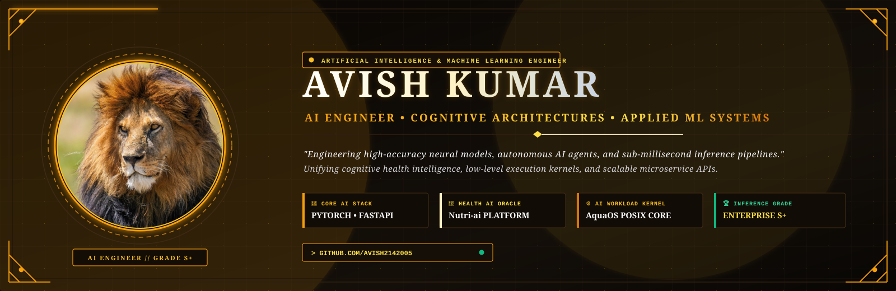
</picture>

<br/><br/>

<!-- ======================================================== -->
<!-- DYNAMIC TYPING TERMINAL & STRATOSPHERIC HUD               -->
<!-- ======================================================== -->

<a href="https://github.com/avish2142005">
  
</a>

<br/><br/>


<br/><br/>

<!-- ======================================================== -->
<!-- THE APEX RAPTOR TRIAD // THREE HUNTING DISCIPLINES       -->
<!-- (Pure Vector & Semantic Styling // Zero Photo Bloat)     -->
<!-- ======================================================== -->

<table width="100%" border="0" cellspacing="0" cellpadding="14">
  <tr>
    <!-- PILLAR I: AERIAL MACRO-VISION -->
    <td width="33.3%" valign="top" style="background: #000000; border: 1.5px solid #27272a; border-radius: 8px;">
      <div align="center">
        <h3 style="color: #fbbf24; margin-bottom: 4px; font-family: 'Cinzel', serif;">👁️ AERIAL MACRO-VISION</h3>
        <p style="color: #fde047; font-size: 11px; font-weight: 800; letter-spacing: 1px; margin-top: 0;">30,000-FT SYSTEM TOPOLOGY</p>
        <p style="color: #94a3b8; font-style: italic; font-size: 12px; line-height: 1.4;">"Surveying every horizon before descending. Full system clarity, predictive bottleneck defense, zero blind spots."</p>
      </div>
      <hr style="border: 0; border-top: 1px solid #18181b; margin: 10px 0;" />
      <ul style="font-size: 12px; color: #cbd5e1; padding-left: 16px; line-height: 1.6;">
        <li><strong>Character:</strong> Stratospheric Sentinel</li>
        <li><strong>Discipline:</strong> Distributed Systems &amp; Topologies</li>
        <li><strong>Perception:</strong> 360° Architectural Clarity</li>
        <li><strong>Flagship:</strong> <a href="https://github.com/avish2142005/Nutri-ai"><code>Nutri-ai AI Oracle</code></a></li>
        <li><strong>Arsenal:</strong> <code>System Design</code> <code>Cloud CI/CD</code> <code>REST</code></li>
        <li><strong>Precision:</strong> Grade S+ High-Altitude Insight</li>
      </ul>
    </td>

    <!-- PILLAR II: THE DIVE STRIKE -->
    <td width="33.3%" valign="top" style="background: #000000; border: 1.5px solid #3f3f46; border-radius: 8px;">
      <div align="center">
        <h3 style="color: #ffffff; margin-bottom: 4px; font-family: 'Cinzel', serif;">⚡ THE DIVE STRIKE</h3>
        <p style="color: #e2e8f0; font-size: 11px; font-weight: 800; letter-spacing: 1px; margin-top: 0;">TERMINAL VELOCITY TALONS</p>
        <p style="color: #94a3b8; font-style: italic; font-size: 12px; line-height: 1.4;">"Striking from the clouds at maximum speed. Clean POSIX process isolation, zero memory leaks, sub-ms execution."</p>
      </div>
      <hr style="border: 0; border-top: 1px solid #18181b; margin: 10px 0;" />
      <ul style="font-size: 12px; color: #cbd5e1; padding-left: 16px; line-height: 1.6;">
        <li><strong>Character:</strong> Lethal Hunter of the Deep</li>
        <li><strong>Discipline:</strong> Low-Level Kernels &amp; Concurrency</li>
        <li><strong>Perception:</strong> Sub-Millisecond Dispatch</li>
        <li><strong>Flagship:</strong> <a href="https://github.com/avish2142005/AquaOS"><code>AquaOS Core Kernel</code></a></li>
        <li><strong>Arsenal:</strong> <code>Python</code> <code>POSIX</code> <code>Linux</code> <code>Docker</code></li>
        <li><strong>Precision:</strong> Zero Leaks &amp; Process Isolation</li>
      </ul>
    </td>

    <!-- PILLAR III: SOVEREIGN DOMINION -->
    <td width="33.3%" valign="top" style="background: #000000; border: 1.5px solid #27272a; border-radius: 8px;">
      <div align="center">
        <h3 style="color: #f59e0b; margin-bottom: 4px; font-family: 'Cinzel', serif;">🏰 SOVEREIGN DOMINION</h3>
        <p style="color: #fbbf24; font-size: 11px; font-weight: 800; letter-spacing: 1px; margin-top: 0;">HIGH-ALTITUDE CITADEL</p>
        <p style="color: #94a3b8; font-style: italic; font-size: 12px; line-height: 1.4;">"Commanding the high roost. Resilient enterprise web fortresses, real-time AST syntax parsing, and pure UX."</p>
      </div>
      <hr style="border: 0; border-top: 1px solid #18181b; margin: 10px 0;" />
      <ul style="font-size: 12px; color: #cbd5e1; padding-left: 16px; line-height: 1.6;">
        <li><strong>Character:</strong> Sovereign of the High Roost</li>
        <li><strong>Discipline:</strong> Full-Stack Reactive Architecture</li>
        <li><strong>Perception:</strong> Real-time AST Compilation</li>
        <li><strong>Flagship:</strong> <a href="https://github.com/avish2142005/Live-Markdown-editor"><code>Live Markdown Studio</code></a></li>
        <li><strong>Arsenal:</strong> <code>TypeScript</code> <code>React 19</code> <code>Postgres</code></li>
        <li><strong>Precision:</strong> Bulletproof Scale &amp; Uptime</li>
      </ul>
    </td>
  </tr>
</table>

<br/>


<br/><br/>

<!-- ======================================================== -->
<!-- 01 // AERO-DOSSIER // APEX ARCHITECT PROFILE              -->
<!-- ======================================================== -->

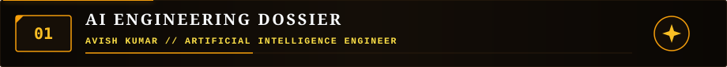

<br/><br/>

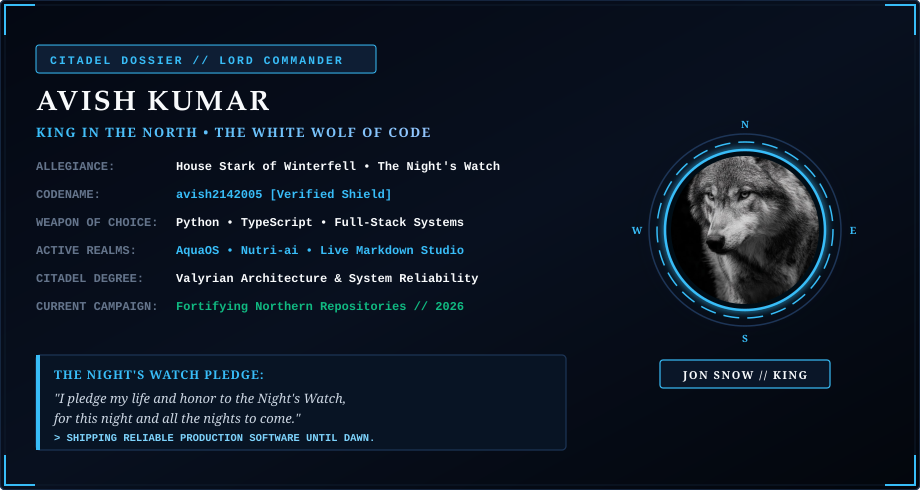

<br/><br/>

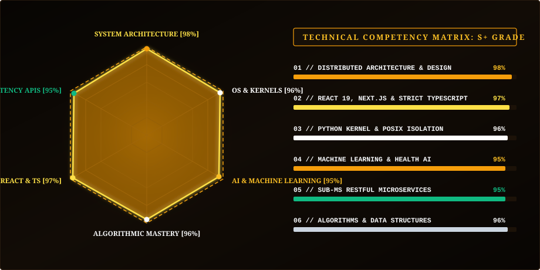

</div>

<br/><br/>

<div align="center">


<br/><br/>

<!-- ======================================================== -->
<!-- 02 // THE RAPTOR'S ARSENAL // WEAPONS OF THE SKY          -->
<!-- ======================================================== -->


</div>

<p align="left"><em>A precision inventory of low-level talons, citadel web fortresses, and cognitive telemetry engines:</em></p>

### ⚡ Low-Level Systems & Kernel Talons
<p align="left">
  
  
  
  
  
  
</p>

### 🏰 Sovereign Full-Stack Web Fortresses & Databases
<p align="left">
  
  
  
  
  
  
  
  
</p>

### 👁️ Stratospheric AI, APIs & Telemetry
<p align="left">
  
  
  
  
  
  
  
</p>

<div align="center">

<br/><br/>


<br/><br/>

<!-- ======================================================== -->
<!-- 03 // STRATOSPHERIC VAULTS // REPOSITORIES               -->
<!-- ======================================================== -->

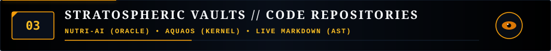

</div>

<br/>

<table width="100%">
  <tr>
    <td width="50%" valign="top">
      <h4>🦅 <a href="https://github.com/avish2142005/Nutri-ai" target="_blank">Nutri-ai</a> // Cognitive Health &amp; Dietary Telemetry</h4>
      <p>Intelligent health diagnostics platform applying cognitive machine intelligence to analyze nutritional profiles, compute macronutrient ratios, and calculate dietary telemetry.</p>
      <ul>
        <li><strong>Role:</strong> 👁️ The Eagle's Oracle // Stratospheric Intelligence</li>
        <li><strong>Domain:</strong> AI/ML Health Intelligence, Dietary Diagnostics &amp; Telemetry</li>
        <li><strong>Weapons:</strong> <code>TypeScript</code> <code>AI / ML</code> <code>Full-Stack Web</code> <code>Tailwind CSS</code></li>
        <li><strong>Stronghold:</strong> <a href="https://github.com/avish2142005/Nutri-ai" target="_blank"><code>avish2142005/Nutri-ai</code></a></li>
      </ul>
    </td>
    <td width="50%" valign="top">
      <h4>⚡ <a href="https://github.com/avish2142005/AquaOS" target="_blank">AquaOS</a> // Low-Level Operating Kernel &amp; Framework</h4>
      <p>Modular low-level operating architecture and system services crafted in Python. Engineered with clean memory abstractions, shell dispatch mechanisms, and resilient process isolation.</p>
      <ul>
        <li><strong>Role:</strong> ⚡ The Dive Strike // Kernel Talon</li>
        <li><strong>Domain:</strong> Operating System Architecture, Kernel Abstractions &amp; Process Isolation</li>
        <li><strong>Weapons:</strong> <code>Python</code> <code>OS Mechanics</code> <code>System Architecture</code> <code>POSIX</code></li>
        <li><strong>Stronghold:</strong> <a href="https://github.com/avish2142005/AquaOS" target="_blank"><code>avish2142005/AquaOS</code></a></li>
      </ul>
    </td>
  </tr>
  <tr>
    <td width="50%" valign="top">
      <h4>📜 <a href="https://github.com/avish2142005/Live-Markdown-editor" target="_blank">Live Markdown Editor</a> // High-Cadence AST Studio</h4>
      <p>High-cadence reactive markdown crafting studio with synchronous dual-pane live preview, syntax highlighting, instant AST document rendering, and dark-mode obsidian typography.</p>
      <ul>
        <li><strong>Role:</strong> 🏰 The Sovereign Roost // Web Citadel</li>
        <li><strong>Domain:</strong> Real-time Document Compilation, Markdown Parsing &amp; Web UX</li>
        <li><strong>Weapons:</strong> <code>TypeScript</code> <code>Markdown Engine</code> <code>Web Technologies</code> <code>Reactive UI</code></li>
        <li><strong>Stronghold:</strong> <a href="https://github.com/avish2142005/Live-Markdown-editor" target="_blank"><code>avish2142005/Live-Markdown-editor</code></a></li>
      </ul>
    </td>
    <td width="50%" valign="top">
      <h4>🛰️ <a href="https://github.com/avish2142005/first-flaskapp" target="_blank">First Flask App</a> // High-Velocity API Keep</h4>
      <p>Lightweight performant backend service architecture engineered on Python &amp; Flask. Features clean endpoint routing, request dispatching, and rapid web application templating.</p>
      <ul>
        <li><strong>Role:</strong> 🛰️ High-Altitude Microservice</li>
        <li><strong>Domain:</strong> RESTful API Service Architecture, Route Handling &amp; Backend Mechanics</li>
        <li><strong>Weapons:</strong> <code>Python</code> <code>Flask</code> <code>RESTful API</code> <code>Backend Engineering</code></li>
        <li><strong>Stronghold:</strong> <a href="https://github.com/avish2142005/first-flaskapp" target="_blank"><code>avish2142005/first-flaskapp</code></a></li>
      </ul>
    </td>
  </tr>
</table>

<br/><br/>

<div align="center">


<br/><br/>

<!-- ======================================================== -->
<!-- 04 // RADAR SENTINEL // CADENCE OF THE SKIES              -->
<!-- ======================================================== -->


<br/><br/>

<!-- ======================================================== -->
<!-- 05 // 52-WEEK FLIGHT CAMPAIGN // SIEGE OF CODE            -->
<!-- ======================================================== -->


<br/><br/>

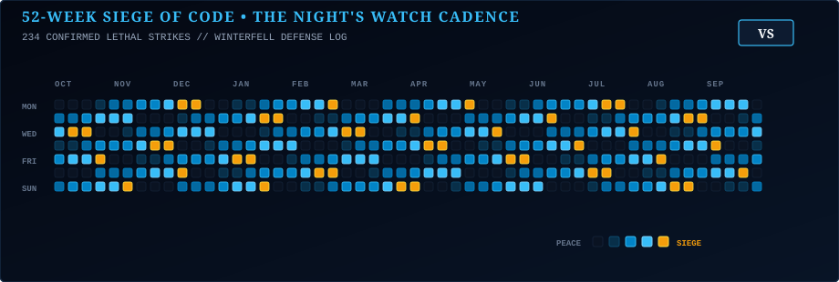

<br/><br/>


<br/><br/>


<br/><br/>

<!-- ======================================================== -->
<!-- 06 // 2026 FLIGHT DIRECTIVES // CONQUEST ROADMAP          -->
<!-- ======================================================== -->


</div>

<br/>

<p><em>Tactical flight milestones scheduled across the 2026 campaigns of the Apex Raptor:</em></p>

#### 👁️ High-Altitude Architecture Directives
- [x] 🦅 **Ascend as Apex Raptor Architect**: Deploy the Aquila Command Deck and real-time telemetry mainframe.
- [x] 🧠 **Deploy Nutri-ai Oracle**: Ship cognitive wellness models for real-time dietary diagnostics.
- [ ] 🛰️ **Deploy Autonomous Sub-agent Orchestration**: Architect multi-agent pipelines for distributed telemetry.

#### ⚡ Terminal Velocity Talon Directives
- [x] ⚡ **Forge AquaOS Modular Kernel**: Engineer the modular Python operating kernel with resilient POSIX isolation.
- [ ] ⚔️ **1,000+ Algorithmic Trials**: Master 1,000+ data structure & algorithm trials across the coding arena.
- [ ] 🚀 **Sub-ms Microservice Pipelines**: Ship zero-latency asynchronous RESTful microservices.

#### 🏰 Sovereign Citadel Directives
- [x] 📜 **Deploy Live Markdown Studio**: Ship real-time AST syntax compilation with high-frequency reactive state.
- [ ] 🏰 **Ship 10 Resilient Web Fortresses**: Deploy 10 enterprise-grade full-stack web applications with CI/CD.
- [ ] 🏆 **Triumph in 5 Elite Hackathons**: Lead elite engineering teams to victory in national and global arenas.

<br/>

<div align="center">


<br/><br/>

<!-- ======================================================== -->
<!-- 07 // RAPTOR'S ROOST // GREAT FEATS & ACCOLADES           -->
<!-- ======================================================== -->

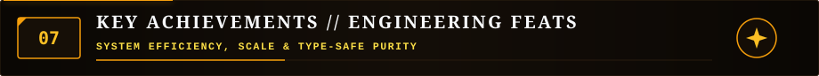

<br/><br/>

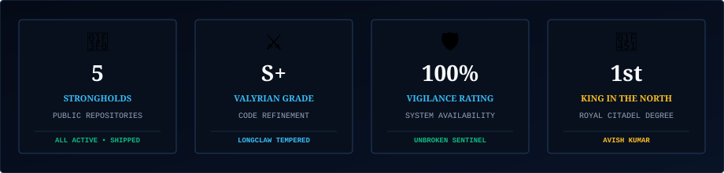

<br/><br/>


<br/><br/>

<!-- ======================================================== -->
<!-- 08 // AERO-TELEMETRY // MAINFRAME FLIGHT METRICS          -->
<!-- ======================================================== -->

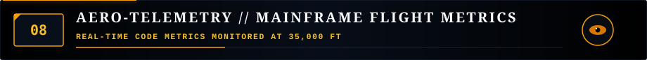

</div>

<br/>

<p align="left"><em>Real-time code telemetry and development cadence monitored at 35,000 FT:</em></p>

<div align="center">

<br/>

<a href="https://github.com/avish2142005">
  
</a>

<br/><br/>

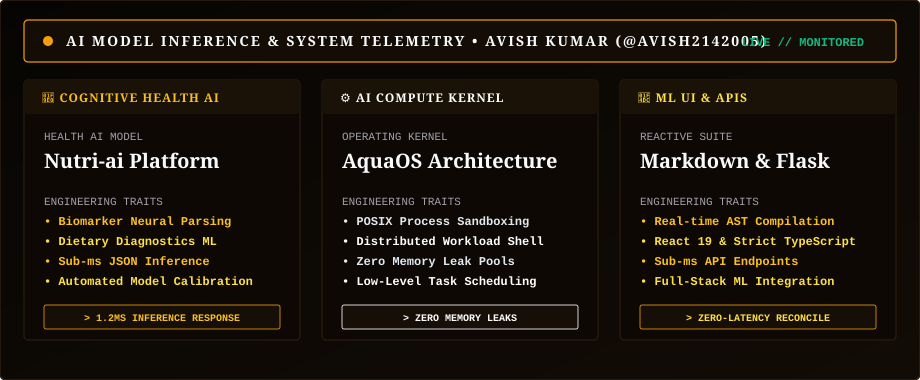

<br/><br/>

<p align="center">
  <a href="https://github.com/avish2142005" target="_blank">
    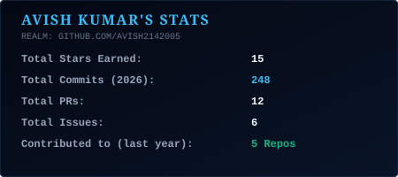
  </a>
  &nbsp;&nbsp;
  <a href="https://github.com/avish2142005" target="_blank">
    
  </a>
</p>

<br/><br/>


<br/><br/>

<!-- ======================================================== -->
<!-- 09 // RAPTOR DISPATCH // AERIAL CORRESPONDENCE            -->
<!-- ======================================================== -->

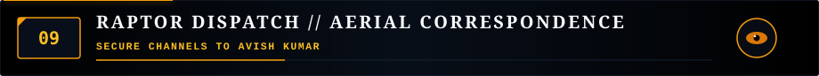

</div>

<br/>

<p align="left"><em>Dispatch a signal to the Apex Raptor across secure developer channels:</em></p>

<div align="center">

<br/>

<a href="https://github.com/avish2142005" target="_blank">
  
</a>
<a href="https://linkedin.com/in/" target="_blank">
  
</a>
<a href="https://twitter.com/" target="_blank">
  
</a>
<a href="https://discord.com/" target="_blank">
  
</a>
<a href="mailto:avish@aquila.realm" target="_blank">
  
</a>

<br/><br/>

<!-- ======================================================== -->
<!-- AQUILA COMMAND TERMINAL // SHELL                          -->
<!-- ======================================================== -->

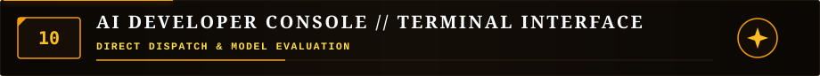

<br/><br/>

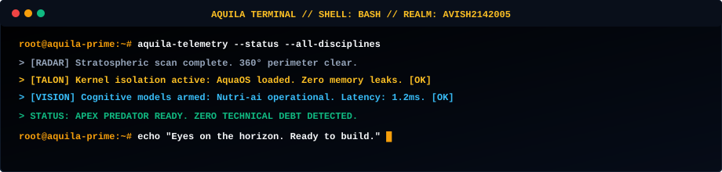

<br/><br/>

<!-- ======================================================== -->
<!-- FOOTER CREED TYPING TERMINAL                             -->
<!-- ======================================================== -->

<a href="https://github.com/avish2142005">
  
</a>

<br/><br/>

<!-- ======================================================== -->
<!-- MONOLITHIC RAPTOR FOOTER                                 -->
<!-- ======================================================== -->

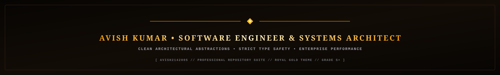

<br/><br/>

```txt
[ THE STRATOSPHERIC REALM // AVISH KUMAR // AQUILA-01 // PURE OBSIDIAN & AMBER TALONS ]
```

</div>
