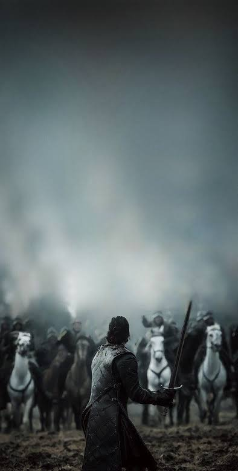
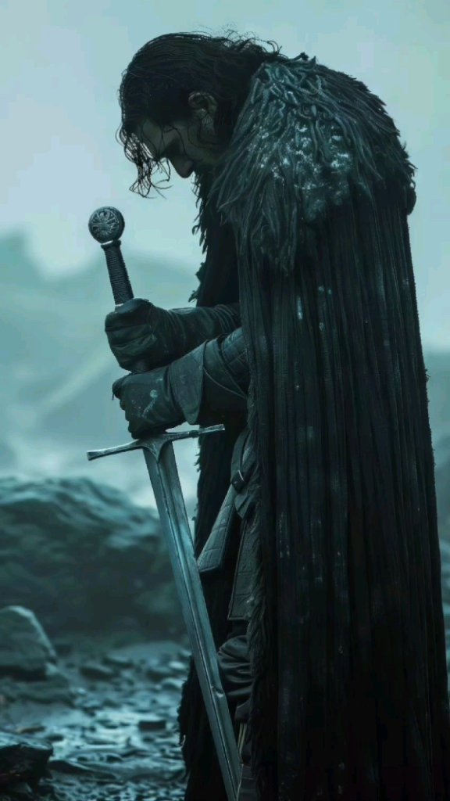

<div align="center">

<!-- ======================================================== -->
<!-- 00 // HERO BANNER & VALYRIAN IDENTITY                     -->
<!-- ======================================================== -->

<picture>
  <source media="(max-width: 768px)" srcset="./assets/got-hero-banner.svg">
  
</picture>

<br/><br/>

<!-- ======================================================== -->
<!-- NIGHT'S WATCH DYNAMIC TYPING TERMINAL & HUD              -->
<!-- ======================================================== -->

<a href="https://github.com/avish2142005">
  
</a>

<br/><br/>


<!-- ======================================================== -->
<!-- JON SNOW // THE WHITE WOLF OF CODE CHRONICLES            -->
<!-- ======================================================== -->

<table width="100%" border="0" cellspacing="0" cellpadding="0">
  <tr>
    <td width="25%" align="center" valign="middle">
      
      <br/>
      <sub><strong style="color: #38bdf8;">I. THE LORD COMMANDER</strong></sub>
    </td>
    <td width="25%" align="center" valign="middle">
      
      <br/>
      <sub><strong style="color: #94a3b8;">II. VALYRIAN STEEL</strong></sub>
    </td>
    <td width="25%" align="center" valign="middle">
      
      <br/>
      <sub><strong style="color: #38bdf8;">III. THE STAND</strong></sub>
    </td>
    <td width="25%" align="center" valign="middle">
      
      <br/>
      <sub><strong style="color: #94a3b8;">IV. THE WALL VIGIL</strong></sub>
    </td>
  </tr>
</table>

<br/>


<br/><br/>

<!-- ======================================================== -->
<!-- 01 // WARRIOR PROFILE // LORD OF WINTERFELL               -->
<!-- ======================================================== -->


<br/><br/>


<br/><br/>


</div>

<br/><br/>

<div align="center">


<br/><br/>

<!-- ======================================================== -->
<!-- 02 // VALYRIAN ARSENAL // WEAPONS OF CODE                 -->
<!-- ======================================================== -->


</div>

<p align="left"><em>An inventory of ancestral tongues, fortifications, and siege engines deployed across open-source campaigns:</em></p>

### ⚔️ Valyrian Blades // Programming Tongues
<p align="left">
  
  
  
  
  
  
</p>

### 🛡️ Castles & Strongholds // Frameworks & Libraries
<p align="left">
  
  
  
  
  
  
</p>

### ⚗️ Citadel Alchemy // Systems & Backend
<p align="left">
  
  
  
  
</p>

### 🏰 Vaults of the Realm // Databases & Infrastructure
<p align="left">
  
  
  
  
  
  
</p>

<div align="center">

<br/><br/>


<br/><br/>

<!-- ======================================================== -->
<!-- 03 // CITADEL SCROLLS // REALM REPOSITORIES               -->
<!-- ======================================================== -->


</div>

<br/>

<table width="100%">
  <tr>
    <td width="50%" valign="top">
      <h4>❄️ <a href="https://github.com/avish2142005/AquaOS" target="_blank">AquaOS</a> // The Valyrian Kernel &amp; OS Framework</h4>
      <p>Modular low-level operating architecture and system services crafted in Python. Engineered with clean memory abstractions, shell dispatch mechanisms, and resilient process isolation.</p>
      <ul>
        <li><strong>Domain:</strong> Operating System Architecture, Kernel Abstractions &amp; Process Telemetry</li>
        <li><strong>Weapons:</strong> <code>Python</code> <code>OS Mechanics</code> <code>System Architecture</code> <code>POSIX</code></li>
        <li><strong>Stronghold:</strong> <a href="https://github.com/avish2142005/AquaOS" target="_blank"><code>avish2142005/AquaOS</code></a></li>
      </ul>
    </td>
    <td width="50%" valign="top">
      <h4>🧠 <a href="https://github.com/avish2142005/Nutri-ai" target="_blank">Nutri-ai</a> // Maester's Intelligence &amp; Nutrition Oracle</h4>
      <p>Next-generation intelligent wellness platform applying cognitive AI models to analyze dietary metrics, calculate macronutrient bio-composition, and deliver tailored health recommendations.</p>
      <ul>
        <li><strong>Domain:</strong> AI/ML Health Intelligence, Dietary Diagnostics &amp; Reactive Telemetry</li>
        <li><strong>Weapons:</strong> <code>TypeScript</code> <code>AI / ML</code> <code>Full-Stack Web</code> <code>Tailwind CSS</code></li>
        <li><strong>Stronghold:</strong> <a href="https://github.com/avish2142005/Nutri-ai" target="_blank"><code>avish2142005/Nutri-ai</code></a></li>
      </ul>
    </td>
  </tr>
  <tr>
    <td width="50%" valign="top">
      <h4>📜 <a href="https://github.com/avish2142005/Live-Markdown-editor" target="_blank">Live Markdown Editor</a> // The Citadel Parchment Studio</h4>
      <p>High-cadence reactive markdown crafting studio with synchronous dual-pane live preview, syntax highlighting, instant AST document rendering, and dark-mode Valyrian typography.</p>
      <ul>
        <li><strong>Domain:</strong> Real-time Document Compilation, Markdown Parsing &amp; Web UX</li>
        <li><strong>Weapons:</strong> <code>TypeScript</code> <code>Markdown Engine</code> <code>Web Technologies</code> <code>Reactive UI</code></li>
        <li><strong>Stronghold:</strong> <a href="https://github.com/avish2142005/Live-Markdown-editor" target="_blank"><code>avish2142005/Live-Markdown-editor</code></a></li>
      </ul>
    </td>
    <td width="50%" valign="top">
      <h4>🏰 <a href="https://github.com/avish2142005/first-flaskapp" target="_blank">First Flask App</a> // Winterfell Keep Microservice</h4>
      <p>Lightweight performant backend service architecture engineered on Python &amp; Flask. Features clean endpoint routing, request dispatching, and rapid web application templating.</p>
      <ul>
        <li><strong>Domain:</strong> RESTful API Service Architecture, Route Handling &amp; Backend Mechanics</li>
        <li><strong>Weapons:</strong> <code>Python</code> <code>Flask</code> <code>RESTful API</code> <code>Backend Engineering</code></li>
        <li><strong>Stronghold:</strong> <a href="https://github.com/avish2142005/first-flaskapp" target="_blank"><code>avish2142005/first-flaskapp</code></a></li>
      </ul>
    </td>
  </tr>
</table>

<br/><br/>

<div align="center">


<br/><br/>

<!-- ======================================================== -->
<!-- 04 // WATCH ON THE WALL // CODE CADENCE                   -->
<!-- ======================================================== -->


<br/><br/>

<!-- ======================================================== -->
<!-- 05 // BATTLE OF THE CODES // 52-WEEK SIEGE                -->
<!-- ======================================================== -->


<br/><br/>


<br/><br/>


<br/><br/>


<br/><br/>

<!-- ======================================================== -->
<!-- 06 // 2026 CONQUEST DIRECTIVES // THE REALM ROADMAP       -->
<!-- ======================================================== -->


</div>

<br/>

<p><em>Royal milestones scheduled across the 2026 tactical northern campaign:</em></p>

- [x] 🐺 **Ascend as King in the North**: Deploy the Valyrian Command Center and live Night's Watch telemetry.
- [x] 🛡️ **Forge AquaOS Core**: Engineer the modular Python operating kernel with resilient POSIX isolation.
- [x] 🧠 **Deploy Nutri-ai Oracle**: Ship cognitive wellness models for real-time dietary telemetry.
- [ ] 🏰 **Forge 10 Sovereign Web Fortresses**: Ship 10 resilient, production-ready full-stack applications with CI/CD.
- [ ] ⚔️ **1,000+ Algorithmic Directives**: Master 1,000+ data structure & algorithm trials across the coding arena.
- [ ] 🏆 **Triumph in 5 Elite Hackathons**: Lead northern squads to victory in major national and global hackathons.
- [ ] 📈 **Maintain the Unbroken Watch**: Achieve 1,000+ open-source commits with flawless code purity.

<br/>

<div align="center">


<br/><br/>

<!-- ======================================================== -->
<!-- 07 // GREAT HALL OF HEROES // VALYRIAN FEATS              -->
<!-- ======================================================== -->


<br/><br/>


<br/><br/>


<br/><br/>

<!-- ======================================================== -->
<!-- 08 // WEIRWOOD TELEMETRY // SEVEN KINGDOMS METRICS        -->
<!-- ======================================================== -->


</div>

<br/>

<p align="left"><em>Real-time code telemetry and development cadence monitored across the Seven Kingdoms:</em></p>

<div align="center">

<br/>

<a href="https://github.com/avish2142005">
  
</a>

<br/><br/>


<br/><br/>

<p align="center">
  <a href="https://github.com/avish2142005" target="_blank">
    
  </a>
  &nbsp;&nbsp;
  <a href="https://github.com/avish2142005" target="_blank">
    
  </a>
</p>

<br/><br/>


<br/><br/>

<!-- ======================================================== -->
<!-- 09 // SEND A RAVEN // ROYAL CORRESPONDENCE                -->
<!-- ======================================================== -->


</div>

<br/>

<p align="left"><em>Dispatch a raven across developer channels and realms:</em></p>

<div align="center">

<br/>

<a href="https://github.com/avish2142005" target="_blank">
  
</a>
<a href="https://linkedin.com/in/" target="_blank">
  
</a>
<a href="https://twitter.com/" target="_blank">
  
</a>
<a href="https://discord.com/" target="_blank">
  
</a>
<a href="mailto:avish@winterfell.realm" target="_blank">
  
</a>

<br/><br/>

<!-- ======================================================== -->
<!-- WINTERFELL TERMINAL // COMMAND SHELL                     -->
<!-- ======================================================== -->


<br/><br/>


<br/><br/>

<!-- ======================================================== -->
<!-- FOOTER CREED TYPING TERMINAL                             -->
<!-- ======================================================== -->

<a href="https://github.com/avish2142005">
  
</a>

<br/><br/>

<!-- ======================================================== -->
<!-- MONOLITHIC WINTERFELL FOOTER                             -->
<!-- ======================================================== -->


<br/><br/>

```txt
[ THE NORTH REMEMBERS // AVISH KUMAR // CITADEL PROTOCOL 0x777 // VALYRIAN CODE ARMED ]
```

</div>
